<div align="center">

# iWitness

**Anonymous incident reporting for communities: report what you saw, keep who you are private.**


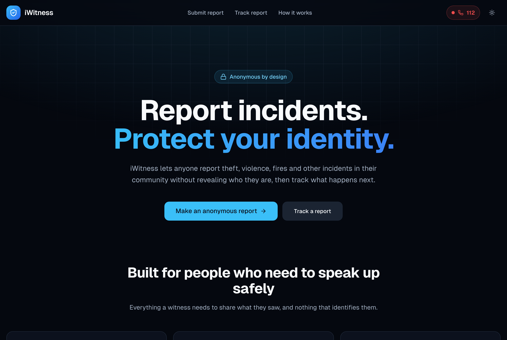

</div>

---

## Table of contents

- [Overview](#overview)
- [Screenshots](#screenshots)
- [Features](#features)
- [Tech stack](#tech-stack)
- [Architecture](#architecture)
- [Project structure](#project-structure)
- [Getting started](#getting-started)
- [Configuration](#configuration)
- [Running the app](#running-the-app)
- [Usage](#usage)
- [Scripts](#scripts)
- [API reference](#api-reference)
- [Testing](#testing)
- [Linting & formatting](#linting--formatting)
- [Deployment](#deployment)
- [Troubleshooting / FAQ](#troubleshooting--faq)
- [Known limitations & roadmap](#known-limitations--roadmap)
- [Contributing](#contributing)
- [License](#license)
- [Credits](#credits)

## Overview

People who witness theft, violence, fires or other incidents often stay silent because they
don't want to be identified. **iWitness** is a web app that lets anyone file a report **without
creating an account or giving their name**. Every report receives a random, private **report ID**
the reporter can use later to check its status.

On the other side, **moderators** (staff accounts with the `ADMIN` or `MODERATOR` role) sign in to a
dashboard to review incoming reports, see the attached location and photo, and move each report
through `Pending → In progress → Resolved / Dismissed`.

Attaching a photo is optional; when a Google Gemini API key is configured, the photo is analysed to
**suggest a title, category and description** that the reporter can review and edit.

**Who it's for:** community safety groups, campuses, housing associations, NGOs or any organisation
that wants a lightweight, self-hosted anonymous tip line, and developers looking for a
well-structured Next.js App Router + Prisma reference project.

## Screenshots

All screenshots were captured from the running app with the seeded demo data.

| Submit a report (validation)                                                                | Report submitted                                                                                    |
| ------------------------------------------------------------------------------------------- | --------------------------------------------------------------------------------------------------- |
| 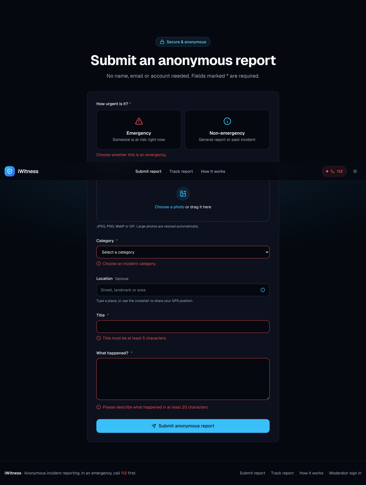 | 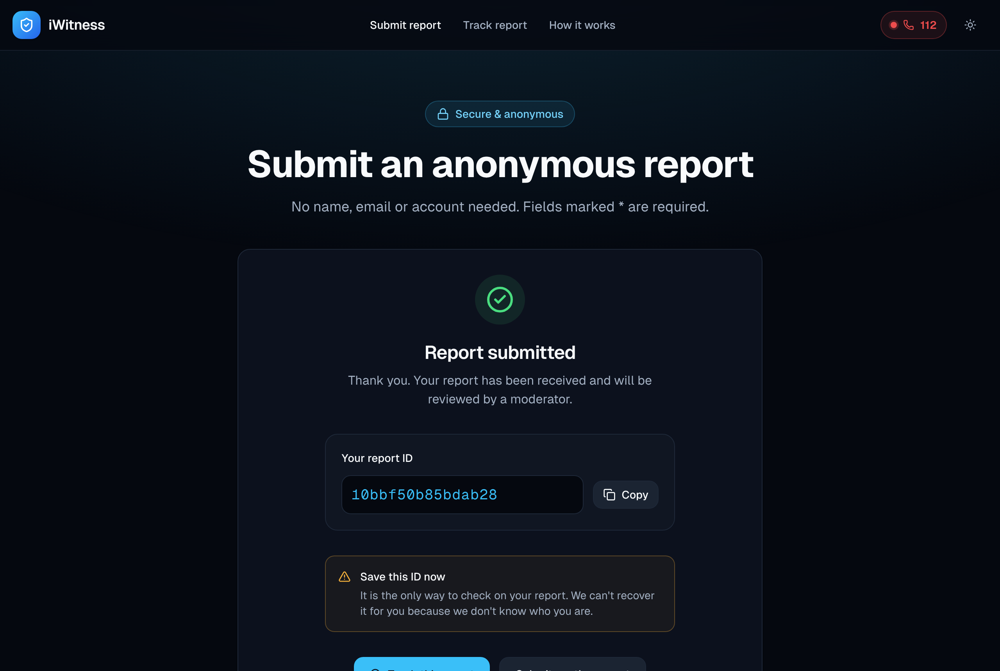 |

| Track a report                                                                             | Moderator dashboard                                                                               |
| ------------------------------------------------------------------------------------------ | ------------------------------------------------------------------------------------------------- |
| 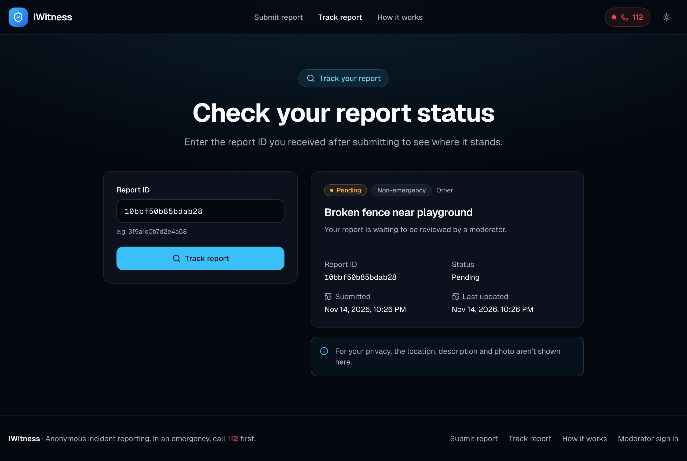 | 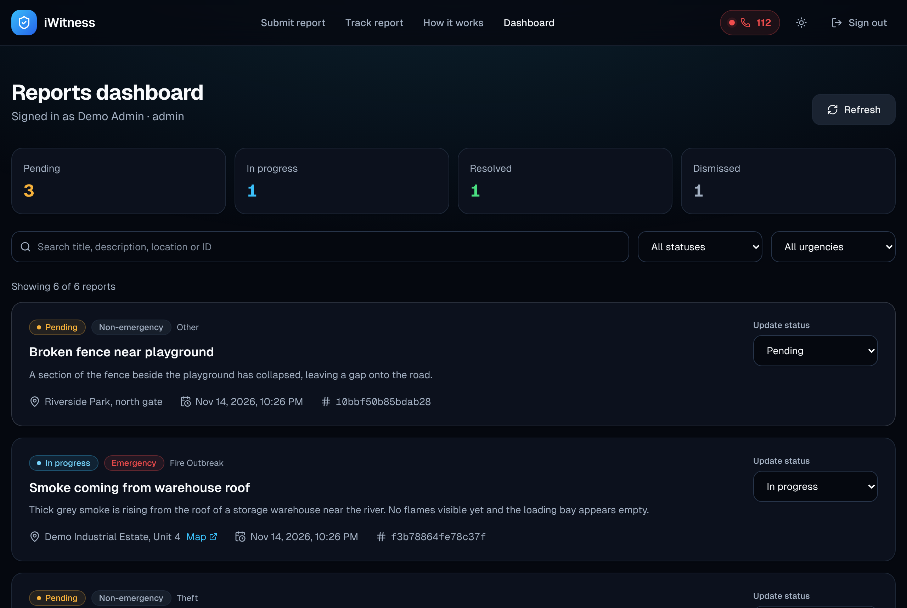 |

| Light theme                                                       | Sign-in error state                                                                     |
| ----------------------------------------------------------------- | --------------------------------------------------------------------------------------- |
| 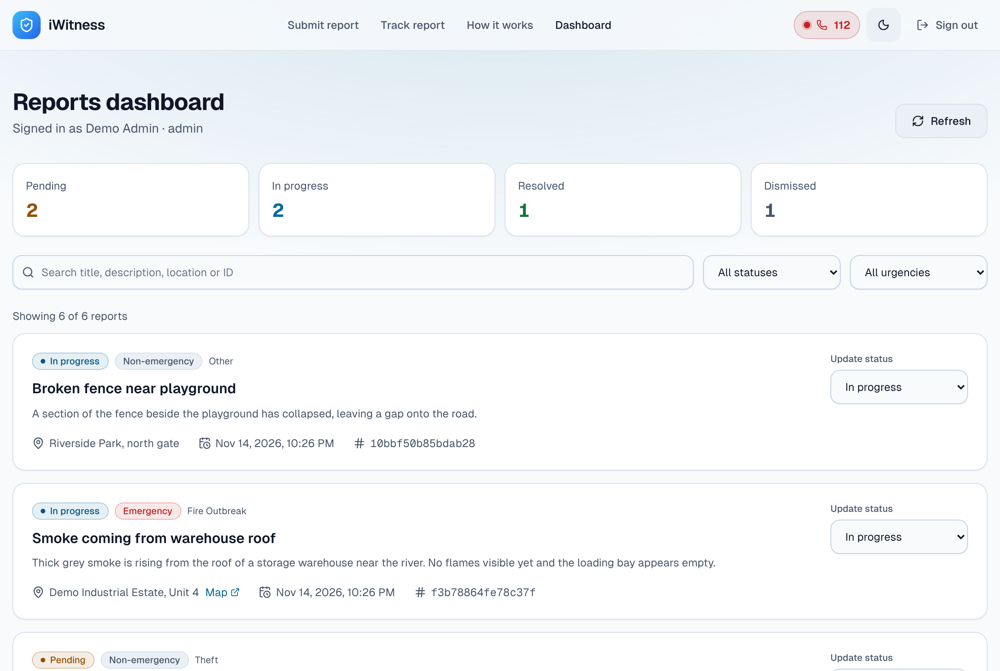 | 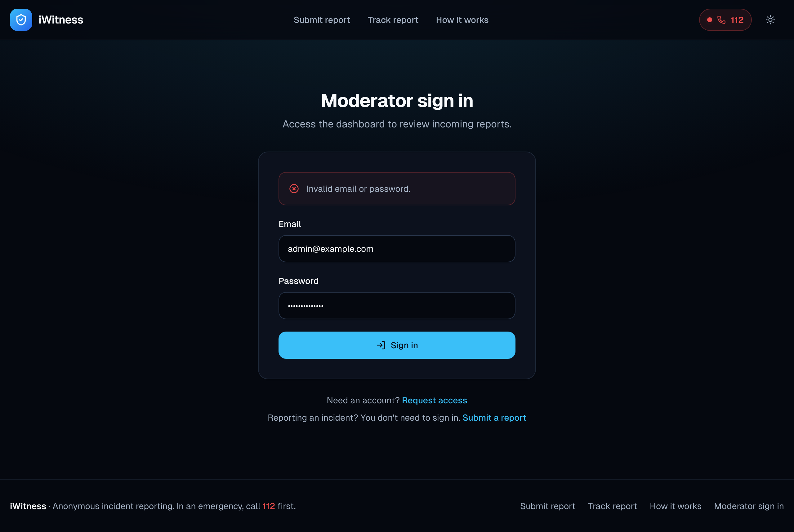 |

<p align="center">
  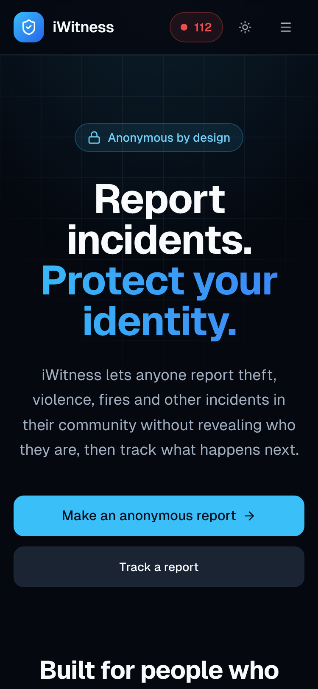
  &nbsp;
  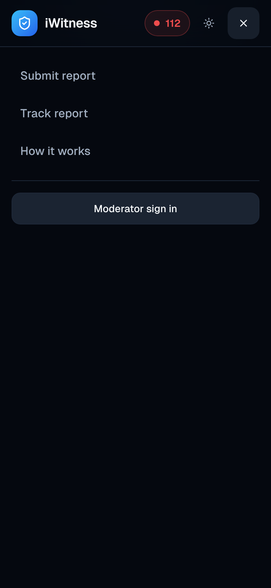
  &nbsp;
  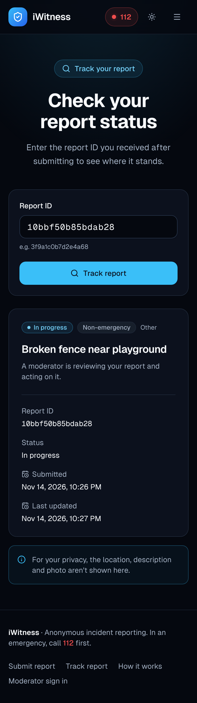
</p>

## Features

**For reporters (no account needed)**

- Emergency / non-emergency selection with a prominent "call 112" prompt for emergencies.
- Category, title, description and optional location fields with inline, accessible validation.
- Location by free text, **Mapbox address autocomplete** (when a token is configured) or one-tap
  **GPS** via the browser Geolocation API.
- Optional **photo evidence** (drag-and-drop or picker); large photos are resized in the browser
  before upload and re-encoded to strip EXIF metadata (max 1600 px, ≤ 5 MB stored).
- **AI-assisted details**: Gemini suggests a title, category and description from the photo.
- Server-generated, unguessable **16-character report ID** with a one-click copy button.
- **Track report** page (`/track-report?id=…`) shows status, title, category and dates only.

**For moderators**

- Credentials sign-in (NextAuth, JWT sessions, bcrypt-hashed passwords).
- Role-gated **dashboard** (middleware + API checks): totals per status, free-text search,
  status and urgency filters, inline status updates with optimistic UI and toasts.
- Evidence images served from an authenticated endpoint and lazy-loaded.
- OpenStreetMap link for reports with GPS coordinates.

**Quality & UX**

- Dark (default) and light themes with a token-based design system and WCAG AA contrast.
- Responsive from 375 px phones to wide desktops; touch-friendly 44 px targets.
- Keyboard-accessible: skip link, visible focus rings, labelled controls, `aria-live` regions.
- Loading skeletons, empty states, error states with retry, 404 and error pages.
- SEO/sharing metadata, generated Open Graph image, SVG favicon, `robots.txt`.
- Security headers, input validation with Zod, per-IP rate limiting on public endpoints.

## Tech stack

| Layer      | Technology                                                                                                                                                                                                 |
| ---------- | ---------------------------------------------------------------------------------------------------------------------------------------------------------------------------------------------------------- |
| Framework  | [Next.js 15](https://nextjs.org/) (App Router, Route Handlers, Middleware)                                                                                                                                 |
| UI         | React 19, [Tailwind CSS 3](https://tailwindcss.com/), [lucide-react](https://lucide.dev/) icons, [sonner](https://sonner.emilkowal.ski/) toasts, [next-themes](https://github.com/pacocoursey/next-themes) |
| Language   | TypeScript (strict)                                                                                                                                                                                        |
| Database   | PostgreSQL via [Prisma ORM 6](https://www.prisma.io/) (works with Neon, Supabase, RDS or local Postgres)                                                                                                   |
| Auth       | [NextAuth.js 4](https://next-auth.js.org/) credentials provider, JWT sessions, bcryptjs                                                                                                                    |
| Validation | [Zod 4](https://zod.dev/), shared by client and server                                                                                                                                                     |
| AI         | Google Gemini via [`@google/genai`](https://www.npmjs.com/package/@google/genai)                                                                                                                           |
| Maps       | [Mapbox Search JS](https://docs.mapbox.com/mapbox-search-js/) address autofill (optional)                                                                                                                  |
| Tooling    | ESLint 9 (`next/core-web-vitals`), Prettier 3, Vitest 5, tsx                                                                                                                                               |

## Architecture

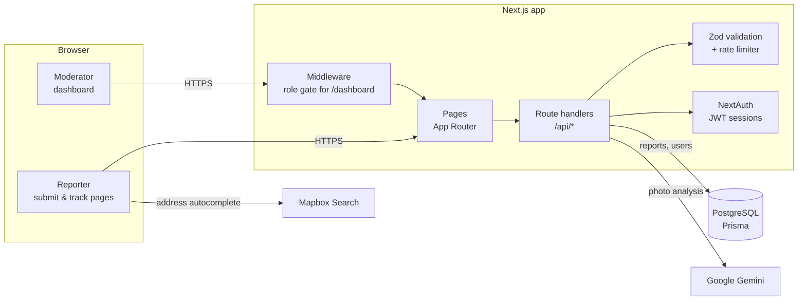

**Request flow for a new report**

1. The reporter fills in the form. The same Zod schema used by the server validates it in the
   browser for instant feedback.
2. If a photo is attached, it's resized client-side and (optionally) sent to `POST /api/analyze-image`,
   which forwards it to Gemini and normalises the answer onto a known category.
3. `POST /api/reports/create` re-validates the payload, **generates the report ID on the server**,
   forces `status = PENDING` and stores the report.
4. The reporter receives the ID; `GET /api/reports/:reportId/details` returns only non-identifying
   fields for later lookups.
5. Moderators load `GET /api/reports` (staff only) and update statuses with
   `PATCH /api/reports/:id`.

**Data model** (`prisma/schema.prisma`)

- `Report`: `id` (internal cuid), `reportId` (public 16-hex ID, unique), `type`
  (`EMERGENCY | NON_EMERGENCY`), `reportType` (category), `title`, `description`, `location`,
  `latitude`, `longitude`, `image` (base64 data URL), `status`, timestamps.
- `User`: staff accounts with `email`, `name`, bcrypt `password` and `role`
  (`ADMIN | MODERATOR | USER`). Reports are **not** linked to users.

## Project structure

```text
.
├── app/                         # Next.js App Router
│   ├── api/
│   │   ├── analyze-image/       # POST: Gemini photo analysis
│   │   ├── auth/
│   │   │   ├── [...nextauth]/   # NextAuth handler
│   │   │   └── signup/          # POST: create a USER account
│   │   └── reports/
│   │       ├── route.ts         # GET: list reports (staff)
│   │       ├── create/          # POST: submit a report (public)
│   │       └── [reportId]/
│   │           ├── route.ts     # PATCH: update status (staff)
│   │           ├── details/     # GET: public status lookup
│   │           └── image/       # GET: evidence image (staff)
│   ├── auth/{signin,signup}/    # Staff auth pages
│   ├── dashboard/               # Moderator dashboard (role-gated)
│   ├── how-it-works/            # Process & privacy explainer
│   ├── submit-report/           # Report form
│   ├── track-report/            # Status lookup
│   ├── layout.tsx               # Root layout, fonts, metadata, header/footer
│   ├── page.tsx                 # Landing page
│   ├── not-found.tsx, error.tsx # 404 and error boundaries
│   ├── opengraph-image.tsx      # Generated social preview image
│   ├── icon.svg, robots.ts
│   └── globals.css              # Design tokens (light/dark)
├── components/
│   ├── ui/                      # Design-system primitives (Button, Input, Card, Alert, …)
│   ├── layout/                  # Header, footer, theme toggle, logo
│   ├── report/                  # Report form, location input, tracker, success view
│   ├── dashboard/               # Moderator dashboard
│   └── auth/                    # Sign-in / sign-up forms
├── lib/
│   ├── ai.ts                    # Gemini call + response parsing/normalisation
│   ├── api.ts                   # JSON error helpers, Prisma error detection
│   ├── auth.ts                  # NextAuth options, credential check, staff session helper
│   ├── client-image.ts          # Browser-side image resize
│   ├── constants.ts             # Categories, statuses, roles, limits, labels
│   ├── image.ts                 # Data-URL validation (type allow-list, size limit)
│   ├── prisma.ts                # Prisma client singleton
│   ├── rate-limit.ts            # In-memory fixed-window rate limiter
│   ├── report-id.ts             # Report ID format helpers (isomorphic)
│   ├── report-id.server.ts      # Report ID generation (node:crypto)
│   ├── roles.ts, site.ts, utils.ts
│   └── validation.ts            # Zod schemas shared by client and server
├── prisma/
│   ├── schema.prisma
│   ├── migrations/
│   └── seed.ts                  # Admin account + demo reports
├── scripts/set-role.ts          # Grant a role to an account
├── tests/                       # Vitest unit & route-handler tests
├── types/next-auth.d.ts         # Session/JWT type augmentation
├── docs/screenshots/            # README screenshots
├── middleware.ts                # Protects /dashboard
└── .env.example                 # Every supported environment variable
```

## Getting started

### Prerequisites

- **Node.js 20.9+** (Node 22 LTS recommended) and npm
- **PostgreSQL 14+**: a local install, Docker, or a hosted database such as [Neon](https://neon.tech/)
- Optional: a [Google AI Studio](https://aistudio.google.com/) API key (photo analysis) and a
  [Mapbox](https://account.mapbox.com/) public token (address autocomplete)

### Installation

```bash
# 1. Clone and install (postinstall runs `prisma generate`)
git clone https://github.com/jeevithg090/iWitness.git
cd iWitness
npm install

# 2. Configure environment
cp .env.example .env
#    then edit .env: at minimum set DATABASE_URL and NEXTAUTH_SECRET
#    (generate a secret with: openssl rand -base64 32)

# 3. Create the database schema
npm run db:deploy        # applies prisma/migrations

# 4. Create the first admin (+ demo reports in development)
#    set SEED_ADMIN_EMAIL and SEED_ADMIN_PASSWORD in .env first
npm run db:seed

# 5. Start the dev server
npm run dev              # http://localhost:3000
```

Need a local Postgres quickly? With Docker:

```bash
docker run -d --name iwitness-db -p 5432:5432 \
  -e POSTGRES_USER=iwitness -e POSTGRES_PASSWORD=iwitness -e POSTGRES_DB=iwitness \
  postgres:16
```

This matches the default `DATABASE_URL` in `.env.example`.

## Configuration

All configuration is through environment variables (see [`.env.example`](.env.example)).

| Variable                          | Required             | Default                 | Description                                                                                                                                     |
| --------------------------------- | -------------------- | ----------------------- | ----------------------------------------------------------------------------------------------------------------------------------------------- |
| `DATABASE_URL`                    | **Yes**              | –                       | PostgreSQL connection string used by Prisma.                                                                                                    |
| `NEXTAUTH_SECRET`                 | **Yes** (production) | –                       | Secret used to sign session JWTs. Generate with `openssl rand -base64 32`.                                                                      |
| `NEXTAUTH_URL`                    | Yes (production)     | `http://localhost:3000` | Public base URL of the app. Also used as the metadata base for Open Graph URLs.                                                                 |
| `GEMINI_API_KEY`                  | No                   | –                       | Enables AI photo analysis. Without it, the endpoint returns `503` and the form works manually.                                                  |
| `GEMINI_MODEL`                    | No                   | `gemini-2.5-flash`      | Gemini model used for photo analysis.                                                                                                           |
| `NEXT_PUBLIC_MAPBOX_ACCESS_TOKEN` | No                   | –                       | Public Mapbox token for address autocomplete. Without it, the location field is plain text (GPS still works). Exposed to the browser by design. |
| `SEED_ADMIN_EMAIL`                | For seeding          | –                       | Email of the admin account created/promoted by `npm run db:seed`.                                                                               |
| `SEED_ADMIN_PASSWORD`             | For seeding          | –                       | Password for that admin (min 8 characters). Only used when the account is first created.                                                        |
| `SEED_ADMIN_NAME`                 | No                   | `Administrator`         | Display name for the seeded admin.                                                                                                              |

## Running the app

| Mode                     | Commands                                                   |
| ------------------------ | ---------------------------------------------------------- |
| Development (hot reload) | `npm run dev`                                              |
| Production build         | `npm run build` (runs `prisma generate` then `next build`) |
| Production server        | `npm run db:deploy && npm start`                           |

## Usage

### Reporter walkthrough

1. Open **Submit report** (`/submit-report`).
2. Pick **Emergency** or **Non-emergency**. (Emergencies show a reminder to call 112 first.)
3. Optionally add a photo. If AI is enabled, the category, title and description are pre-filled;
   review them.
4. Choose a category, optionally add a location, write a title and description, and submit.
5. Copy your **report ID**. Use **Track this report** or visit `/track-report?id=<your-id>` any time.

### Moderator walkthrough

1. Run `npm run db:seed` to create the admin from `SEED_ADMIN_*`, or sign up at `/auth/signup`
   and have an admin promote you:
   ```bash
   npm run user:role -- someone@example.com MODERATOR
   ```
2. Sign in at `/auth/signin`; you're taken to `/dashboard`.
3. Click a status tile or use the filters/search to narrow the list, then change a report's status
   from its **Update status** dropdown.

> Accounts with the `USER` role can sign in but are told they don't have dashboard access yet.

### API examples

Submit a report:

```bash
curl -X POST http://localhost:3000/api/reports/create \
  -H 'Content-Type: application/json' \
  -d '{
    "type": "NON_EMERGENCY",
    "specificType": "Theft",
    "title": "Bicycle stolen from station rack",
    "description": "A blue bicycle was taken from the north entrance rack between 8am and 6pm.",
    "location": "Central Station, north entrance"
  }'
```

```json
{
  "success": true,
  "reportId": "3f9a1c0b7d2e4a68",
  "message": "Report submitted successfully"
}
```

Validation failure (`400`):

```json
{
  "error": "Please fix the highlighted fields.",
  "fields": { "title": "Title must be at least 5 characters." }
}
```

Check a report's status:

```bash
curl http://localhost:3000/api/reports/3f9a1c0b7d2e4a68/details
```

```json
{
  "reportId": "3f9a1c0b7d2e4a68",
  "type": "NON_EMERGENCY",
  "reportType": "Theft",
  "title": "Bicycle stolen from station rack",
  "status": "PENDING",
  "createdAt": "2026-11-14T22:26:10.000Z",
  "updatedAt": "2026-11-14T22:26:10.000Z"
}
```

## Scripts

| Script                                | What it does                                                          |
| ------------------------------------- | --------------------------------------------------------------------- |
| `npm run dev`                         | Start the Next.js dev server on port 3000.                            |
| `npm run build`                       | Generate the Prisma client and create a production build.             |
| `npm start`                           | Serve the production build.                                           |
| `npm run lint`                        | Run ESLint over the project.                                          |
| `npm run format` / `format:check`     | Format with Prettier / check formatting.                              |
| `npm run typecheck`                   | Type-check with `tsc --noEmit`.                                       |
| `npm test` / `test:watch`             | Run the Vitest suite once / in watch mode.                            |
| `npm run db:migrate`                  | Create & apply a new migration in development (`prisma migrate dev`). |
| `npm run db:deploy`                   | Apply existing migrations (production/CI).                            |
| `npm run db:seed`                     | Create the admin account and demo reports.                            |
| `npm run db:studio`                   | Open Prisma Studio to browse data.                                    |
| `npm run user:role -- <email> <ROLE>` | Grant `ADMIN`, `MODERATOR` or `USER` to an account.                   |

## API reference

| Method     | Path                             | Auth                              | Description                                                                                                                                                             |
| ---------- | -------------------------------- | --------------------------------- | ----------------------------------------------------------------------------------------------------------------------------------------------------------------------- |
| `POST`     | `/api/reports/create`            | Public (rate-limited: 10/hour/IP) | Submit a report. Body: `type`, `specificType`, `title`, `description`, optional `location`, `latitude`, `longitude`, `image` (data URL). Returns `201` with `reportId`. |
| `GET`      | `/api/reports/:reportId/details` | Public (30/min/IP)                | Status lookup by public report ID. Returns only `reportId`, `type`, `reportType`, `title`, `status`, `createdAt`, `updatedAt`.                                          |
| `POST`     | `/api/analyze-image`             | Public (10/10 min/IP)             | Body `{ image }` (data URL). Returns `{ title, reportType, description }`. `503` if Gemini isn't configured.                                                            |
| `GET`      | `/api/reports`                   | Staff (`ADMIN`/`MODERATOR`)       | List up to 200 reports, newest first. Optional `?status=` and `?type=` filters. Includes `hasImage`, excludes image data.                                               |
| `PATCH`    | `/api/reports/:id`               | Staff                             | Body `{ status }`. `:id` is the internal record id. `404` if not found.                                                                                                 |
| `GET`      | `/api/reports/:id/image`         | Staff                             | Evidence image as binary with the correct `Content-Type`.                                                                                                               |
| `POST`     | `/api/auth/signup`               | Public (5/15 min/IP)              | Body `{ name, email, password }`. Always creates a `USER`; returns `409` for duplicate emails.                                                                          |
| `GET/POST` | `/api/auth/*`                    | –                                 | NextAuth endpoints (sign-in, session, CSRF, sign-out).                                                                                                                  |

Errors use a consistent shape: `{ "error": string, "fields"?: Record<string, string> }`.

## Testing

```bash
npm test
```

The Vitest suite (`tests/`) covers the core logic and every API route handler, with Prisma and the
session mocked:

- **Validation** of reports, sign-ups, status updates and dashboard filters (including that
  client-supplied `status`, `reportId` and `role` are ignored).
- **Image handling**: data-URL parsing, type allow-list, size limits.
- **AI response parsing** and category normalisation.
- **Report IDs**: format, uniqueness, normalisation.
- **Rate limiter** windows and client key extraction.
- **Auth**: credential verification, role checks, sign-up always creating `USER` accounts.
- **Route handlers**: create/list/update/details/image endpoints, auth enforcement, 400/401/404/409
  paths and that public lookups never select location, description or image.

The UI flows (submitting, tracking, sign-in, dashboard updates, theme toggle, responsive layouts)
were verified manually in a browser; there are no automated end-to-end tests yet.

## Linting & formatting

- **ESLint 9** with `next/core-web-vitals`, `next/typescript` and `eslint-config-prettier`
  (`eslint.config.mjs`): `npm run lint`
- **Prettier 3** with the Tailwind class-sorting plugin: `npm run format`
- **TypeScript** strict mode: `npm run typecheck`

## Deployment

### Vercel (recommended)

1. Create a PostgreSQL database (e.g. Neon) and copy its connection string.
2. Import the repository in Vercel. The default build command (`npm run build`) already runs
   `prisma generate`.
3. Add the environment variables from the [configuration table](#configuration)
   (`DATABASE_URL`, `NEXTAUTH_SECRET`, `NEXTAUTH_URL` at minimum).
4. Apply migrations against the production database once (from your machine or a release step):
   ```bash
   DATABASE_URL="<production url>" npm run db:deploy
   SEED_ADMIN_EMAIL=... SEED_ADMIN_PASSWORD=... DATABASE_URL="<production url>" npm run db:seed
   ```
   In production the seed only creates the admin; demo reports are skipped.
5. Deploy.

### Any Node host

```bash
npm ci
npm run build
npm run db:deploy
npm start            # listens on $PORT or 3000
```

Run it behind HTTPS (the app sends `Strict-Transport-Security`). If you run more than one instance,
note that the rate limiter is per instance (see limitations).

## Troubleshooting / FAQ

<details>
<summary><strong><code>PrismaClientInitializationError: Can't reach database server</code></strong></summary>

Check that PostgreSQL is running and `DATABASE_URL` is correct. For Neon, include
`?sslmode=require`. Run `npm run db:deploy` after creating the database.
</details>

<details>
<summary><strong>"The table `public.Report` does not exist"</strong></summary>

Migrations haven't been applied. Run `npm run db:deploy` (or `npm run db:migrate` in development).
</details>

<details>
<summary><strong>I can sign in but get "doesn't have moderator access"</strong></summary>

Your account has the `USER` role. Promote it with `npm run user:role -- you@example.com MODERATOR`,
then sign in again (roles are stored in the session token at sign-in).
</details>

<details>
<summary><strong>Photo analysis says it isn't configured</strong></summary>

Set `GEMINI_API_KEY` and restart the server. If you get `502` errors, check the server log; the
configured `GEMINI_MODEL` may not be available to your key.
</details>

<details>
<summary><strong>Address suggestions don't appear</strong></summary>

Set `NEXT_PUBLIC_MAPBOX_ACCESS_TOKEN` and **rebuild** (`NEXT_PUBLIC_*` values are inlined at build
time). Without a token the field is plain text by design.
</details>

<details>
<summary><strong>"Use my location" fails</strong></summary>

Browsers only allow geolocation on HTTPS or `localhost`, and only after the user grants permission.
</details>

<details>
<summary><strong><code>[next-auth][warn][NO_SECRET]</code> or JWT errors in production</strong></summary>

Set `NEXTAUTH_SECRET` and `NEXTAUTH_URL` in the production environment.
</details>

## Known limitations & roadmap

**Limitations (honest list)**

- **Anonymity is application-level.** The app doesn't store IPs or link reports to accounts, but your
  hosting provider, reverse proxy or database host may keep access logs. Report contents, photo
  contents (and metadata in GIFs, which aren't re-encoded) and GPS coordinates can identify a
  reporter. Data is not end-to-end encrypted.
- **Rate limiting is in-memory**, per server instance; use a shared store (e.g. Redis/Upstash) for
  multi-instance deployments.
- **Images are stored in the database** as base64 data URLs (≤ 5 MB each). Fine for small
  deployments; object storage would scale better.
- The dashboard loads at most the 200 newest reports matching the filters; there's no pagination yet.
- No two-way messaging between moderators and reporters, no notifications, no audit log.
- No Content-Security-Policy header yet (Mapbox's widget needs careful allow-listing).

**Roadmap ideas**

- Object storage for evidence (S3/R2) with EXIF stripping for every format.
- Pagination and CSV export in the dashboard; per-report notes and audit trail.
- Anonymous two-way messages keyed by report ID.
- Playwright end-to-end tests.
- Shared rate-limit store and a strict CSP.
- Internationalisation and configurable emergency number per region.

## Contributing

1. Fork the repository and create a feature branch.
2. `npm install`, copy `.env.example` to `.env` and set up a database.
3. Make your change with tests where it makes sense.
4. Before opening a pull request, run:
   ```bash
   npm run lint && npm run typecheck && npm test && npm run build
   ```
5. Use [Conventional Commits](https://www.conventionalcommits.org/) (`feat:`, `fix:`, `docs:` …).

## License

No license has been chosen yet, which means all rights are reserved by default. If you intend others
to use or contribute to this project, consider adding an OSI-approved license such as
[MIT](https://choosealicense.com/licenses/mit/) or
[Apache-2.0](https://choosealicense.com/licenses/apache-2.0/).

## Credits

The original version of this project was built while following a public "build & deploy a crime
report app" tutorial using Next.js, Prisma, Gemini and Tailwind CSS. The current codebase has since
been substantially reworked (security fixes, validation, design system, accessibility, tests and
documentation).
